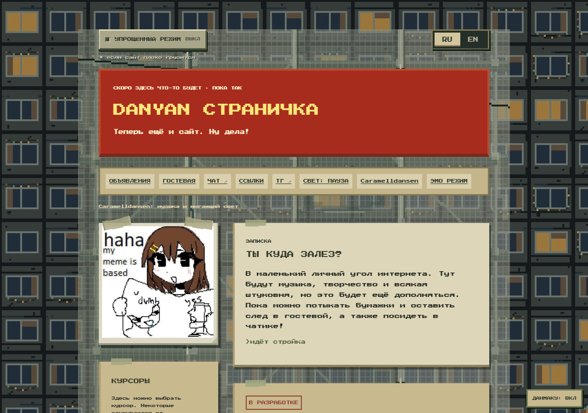

# DANYAN

[Мой сайт](https://danyanspage.neocities.org/)



Моя личная страничка на Neocities. Писалась на обычном JavaScript.
Следы борьбы оставлены, там боль крч.

## Запустить

Нужны Node.js 18+ и Python 3.11+.

```sh
node Инструменты/build.mjs
python -m http.server 8080 --directory publish --bind 127.0.0.1
```

Дальше http://127.0.0.1:8080. После правок снова запусти сборку.

Гостевая локально:

```sh
python Инструменты/guestbook_server.py --port 8768
```

Ключ создастся в `.private/`. Для своего сервера поменяй адрес в settings.js.

## Отдельно

[Данмаку](../Компоненты/Данмаку/README.md)

[Случайный выбор без повторов](../Компоненты/Без-повторов/README.md)

Внутри есть примеры, их можно открыть с диска.

## Где править

Страницы в index.html и chat.html. Оформление рядом, в style.css и chat.css.
Записи лежат в Содержимое/posts.json. Кнопки соседей в Содержимое/buttons.json.
Музыка в Содержимое/emo-tracks.json.

Код под [MIT](../LICENSE). Про сторонние картинки написано в [ASSETS.md](../ASSETS.md).
